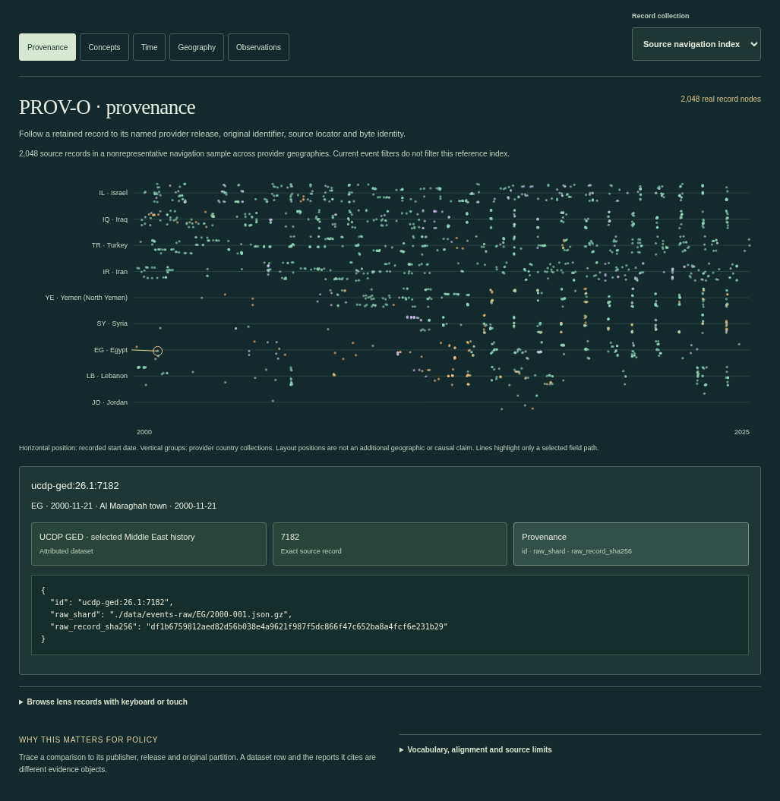
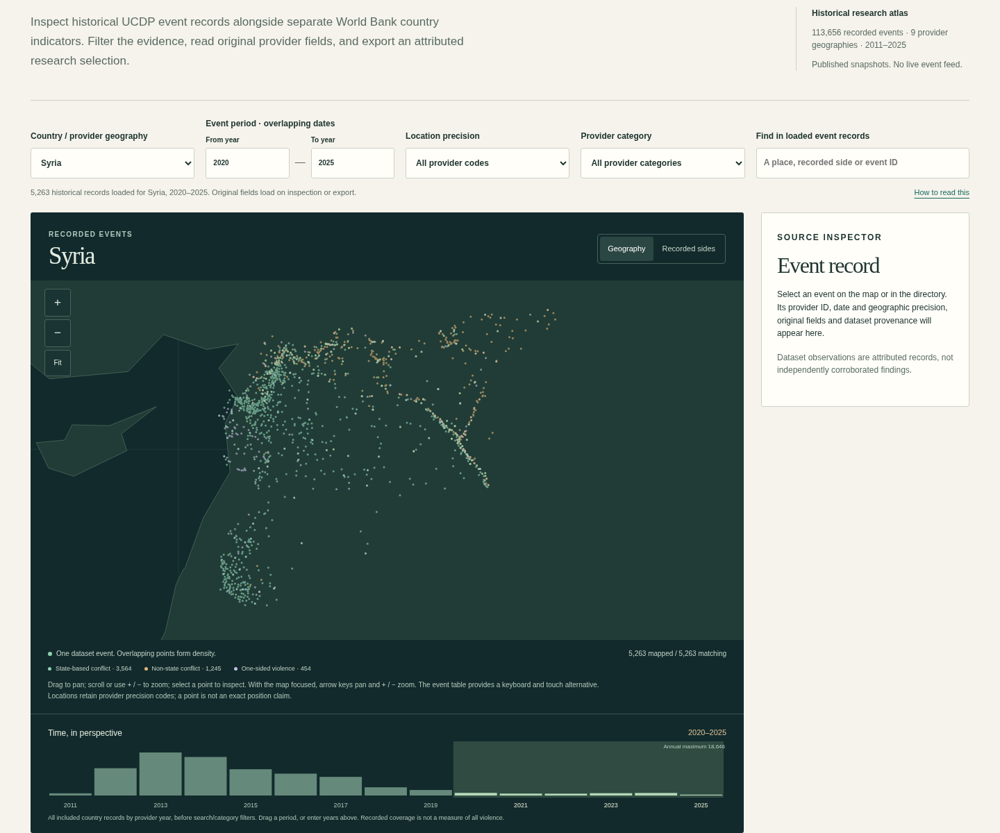
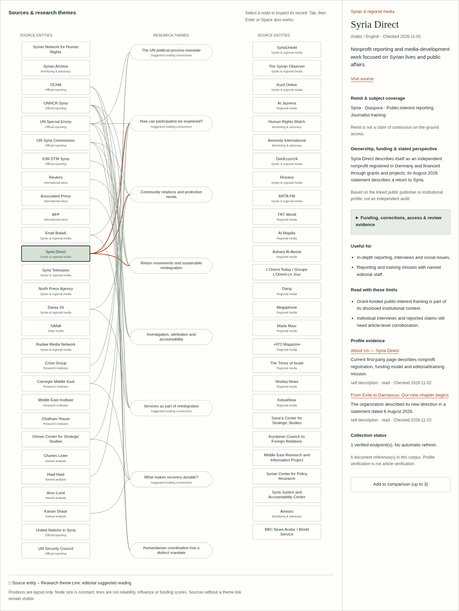
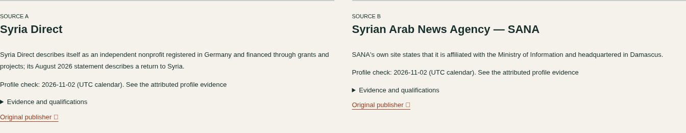
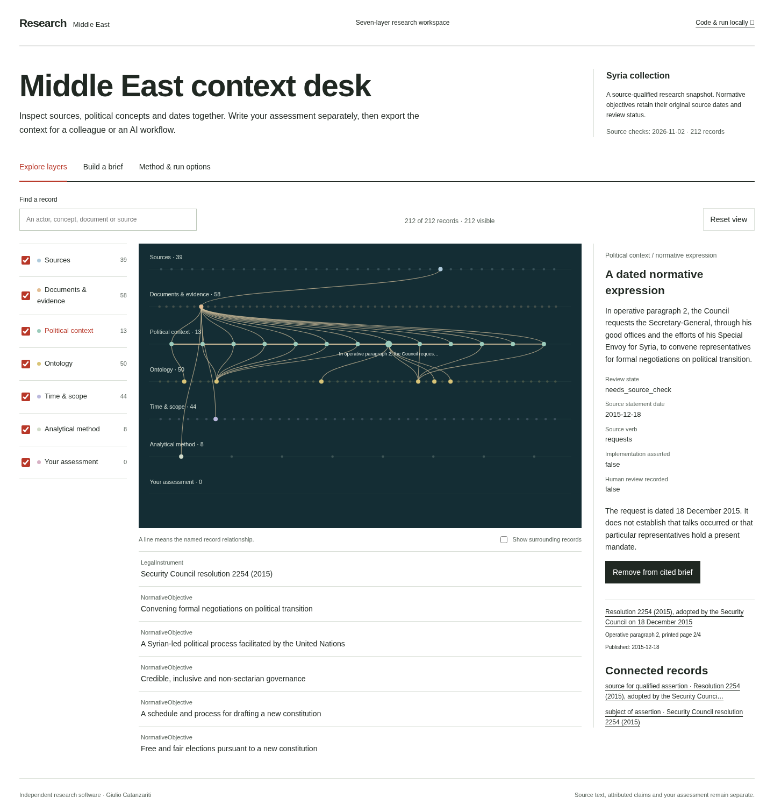
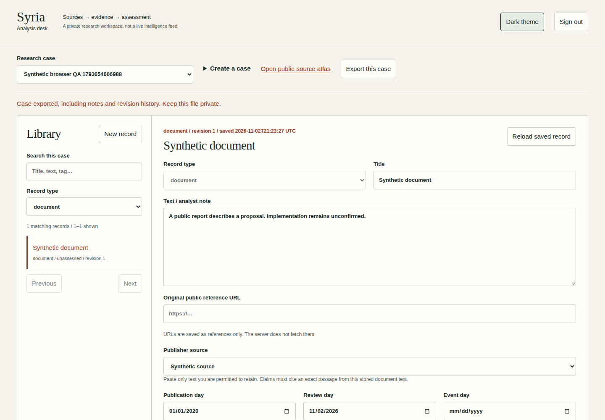
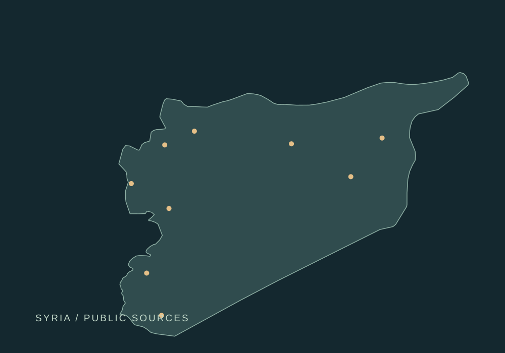
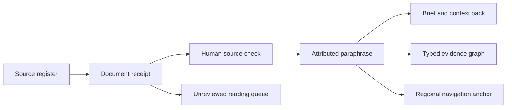

# Middle East · Political Analysis

Explore historical conflict data and build source-qualified policy context. Keep provider records, exact passages and analyst judgments distinct.

**[Historical briefing compiler](docs/historical-briefing.md)** · **[Document semantic layer](docs/document-semantics.md)** · **[Historical change brief](docs/historical-change-brief.md)** · **[Historical research atlas](docs/historical-atlas.md)** · [Real worked selections](examples/historical-research/) · [Data contracts](schemas/research_selection.schema.json)

Explore **120,576 UCDP GED records for 2000–2025** and **15,272 annual World Bank values** across 32 indicators. A linked map and timeline, recorded-sides view and exact source inspector let you investigate a geography or period, inspect precision and export a bounded research selection. Compact map partitions load first; all 49 original event fields load on selection. Annual series retain units, missing years and source qualifications.

The [semantic catalog](docs/semantic-catalog.md) adds five scoped vocabulary lenses, a 2,048-record navigation sample and 188 lazy country/year indexes. PROV-O, SKOS, OWL-Time and GeoSPARQL expose actual source fields; the SOSA/SSN lens uses a concrete annual World Bank result. These are field-navigation alignments, without automatic political inference or a claim of full standards compliance.

The [read-only research database](cloudflare/README.md) adds indexed local SQLite and optional Cloudflare D1 queries, with original fields, source manifests and resumable imports. Query a country, interval, recorded side and precision; inspect the result before preparing a bounded research context. The [lens guide](docs/atlas-lenses.md) explains each mapping and its limits.





```sh
git clone https://github.com/sargonxg/Syria-political-analysis.git
cd Syria-political-analysis
python -m pip install -e .
python scripts/build_showcase.py
python -m http.server 8766 --bind 127.0.0.1 --directory dist
```

Open **http://127.0.0.1:8766/observations/**. No API key, model account or Rust build is needed. The committed, licensed snapshots build without live collection. [Query from Python/CLI, prepare a brief and reopen a selection in Workbench](docs/historical-atlas.md). A static build can be hosted on Cloudflare; the separately authenticated notebook below is a different workflow.

The historical collection has nine UCDP provider country categories; the annual series cover ten World Bank economies. Provider geography is retained, without an independent border determination. This is historical research coverage, not a live event feed, current control map or causal model. Syria remains the first curated political-ontology collection.

**[Assess media framing](docs/media-assessment.md)** · [Research/data resources](data/sources/resources.json)



Navigate 55 publisher and institutional profiles. Compare specific reports across attribution, framing, support, information lineage, scope and language. Select a record in the entered evidence trail to inspect quotations, locators and shared upstream references, with analyst interpretation shown separately. The worksheet exports selected passages and a separate analyst assessment; it does not turn ownership or funding into a political-bias score. Eight data/research resources retain their access prerequisites. [Comparison on mobile](docs/images/source-comparison-mobile.png).



**[Explore the context desk](docs/context-layers.md)** · [Seven-layer JSON snapshot](exports/context-layers.json)



The context desk connects the curated source collection to a seven-layer graph. Inspect a resolution's scope, distinguish a normative request from an implementation finding, select source-linked material and write your own assessment. Download a cited brief or a complete, schema-described JSON context. The screenshot is the actual public research snapshot. [Mobile view](docs/images/context-mobile.png).

```sh
python -m pip install -e .
python scripts/build_showcase.py
python -m http.server 8766 --bind 127.0.0.1 --directory dist
```

Open `http://127.0.0.1:8766`. The build contains only public country records. It runs offline and deploys as static assets on Cloudflare; [run and deployment instructions](docs/context-layers.md). The separate authenticated notebook below adds durable private cases.

**[Beginner quickstart](docs/quickstart.md)** · [Fictional worked case](examples/README.md) · [Cloud/container instructions](docs/deployment.md) · [Contribute](CONTRIBUTING.md)

The public code and sample corpus can be read, cloned and run locally. The optional private desk is a single-operator notebook: all holders of its access key can access all cases. There is no hosted public service or automatic deployment.



The screenshot uses fictional browser-test records only. [Mobile view](docs/images/desk-mobile.png).



An independent, public-source research toolkit by Giulio Catanzariti. Start with a source, preserve what it actually says, and keep the analyst's judgement visible.

**Syria is the first curated country collection.** Shared evidence contracts, collection tools and exports now support isolated country workspaces. The repository URL and `syria-analysis` command remain compatible; `policy-analysis` is the regional command alias. Other countries’ curated source/ontology workspaces begin empty, with no copied Syria claims. The separate historical-data layer has the explicitly documented regional coverage above.

The reconciled corpus contains **55 source profiles, 44 document references, 14 attributed report paraphrases, 14 regional navigation anchors, eight context themes, eight analytical lenses and two social-account links verified through institutional profiles**. The atlas adds 17 explicitly qualified organizational/location relationships. Eight verified RSS endpoints are registered; five publishers supply the existing saved reading sample; the coverage export contains 33 references, including two manually registered SANA language accounts. No social posts have been collected.

The **Syria political ontology** adds 17 entity types, 15 qualified relationship types and 18 source-scoped concepts. Seven entity records and six dated normative assertion drafts provide a working example from Security Council resolution 2254 (2015). Every assertion retains its original source verb, paragraph/page locator, date, modality, qualifications and review state. These historical objectives are not current implementation findings. No human review is claimed for the drafts. [Inspect the model](docs/political-ontology.md).

This is a working foundation, not comprehensive coverage or a live intelligence service. It does not infer current territorial control, assign coordinates to headlines, or score a publisher's credibility.

## Start locally

### Private second-brain desk

The optional **analysis desk** adds a durable, authenticated research workspace: cases, sources, stored document text, claims with exact excerpts and locators, analyst notes, actors/events/themes, search, backlinks, a relationship view, confidence rationales, revision history and private exports. Stale edits return a conflict instead of overwriting newer work. Claim citations pin the document revision used; old paraphrases are imported as attributed notes when their original excerpts are absent.

Start with the [local/container run instructions](docs/deployment.md), [API contracts](docs/desk-api.md), [analytical method](docs/analysis-method.md) and [verification limits](docs/desk-verification.md). Runtime dependency versions are pinned in `requirements-desk.lock`. `Dockerfile` and `compose.yaml` support a single-instance container with persistent storage; the application refuses a missing access key and the default host port is loopback-only. Private databases, keys and backups are ignored by Git and the image build context. There is no URL fetcher, file-parser upload endpoint, automatic RAG service, API fee or cloud account dependency.

**No deployment is performed by these files or workflows.** GitHub Actions runs validation, browser tests and a disposable container smoke test only. It does not publish images or create infrastructure. A cloud operator must separately supply private authentication, an HTTPS/private-access boundary, persistent storage and backups. This is a single-operator desk, not a multi-tenant production service.

### Existing offline toolkit

Python 3.11 or later; no runtime dependencies. Run from this repository:

```sh
python -m venv .venv
. .venv/bin/activate
python -m pip install -e '.[dev,desk,test]'
syria-analysis validate
python -m unittest discover -s tests -v
```

Without installing the package, prefix commands with `PYTHONPATH=src python -m syria_analysis` in place of `syria-analysis`.

## Workflows

### Regional source atlas and comparison worksheet

Open [the built atlas](exports/atlas/index.html) in a browser, or rebuild it from the current validated corpus:

```sh
syria-analysis build-atlas
```

The result is one self-contained HTML file. It works offline without a server, remote scripts, tracking, credentials or runtime dependencies. It is a curated research snapshot, not a live intelligence feed.

The atlas provides:

- A source-to-theme network and a separate documented-relationship graph, with keyboard-selectable records and evidence inspectors.
- Search and combined role, language and theme filters; a complete text directory; visible strengths, limits, access caveats and profile check dates.
- Distinct state-media and monitoring/advocacy categories, alongside local reporting, wires, research institutions, analysts and official primary sources.
- A dated evidence desk and an explicitly unreviewed reading queue.
- Up to three source comparisons and a Markdown worksheet export separating evidence, analyst assessment, alternative explanations and gaps. Drafts are held only in the open page and cleared by reload.
- Light/dark themes and a responsive directory alternative to the horizontally scrollable graph.

Relationship records in [relationships.json](data/sources/relationships.json) contain the exact relation, basis, original profile evidence, review date and caveat. Dashed operating-location links are distinct from solid organizational links. Unknown start/end dates remain null. A first-party disclosure is not an independent audit; no missing edge establishes independence. See [atlas documentation](docs/atlas.md) for graph semantics and checks.

The additional [catalogue review](data/sources/catalogue-review.json) is committed alongside its [methodology](docs/catalogue-methodology.md) and public evidence URLs. It adds 11 sources and supplementary qualifications to 14 existing profiles, including corrections-policy review, funding disclosures and access limits. Historical private input IDs and versions remain optional archival metadata; they are neither public evidence nor required access. `field_evidence` is a relevant-source navigation index, not certified field-level corroboration.

On Windows, use `$env:PYTHONPATH='src'` then `python -m syria_analysis build-atlas` if the package is not installed. The generated file opens directly from Explorer. For browser automation tools that prohibit `file:` URLs, run `python -m http.server 8766 --bind 127.0.0.1` and visit `http://127.0.0.1:8766/exports/atlas/index.html`.

### Command-line research

```sh
# Explicit refresh of the five registered, verified endpoints; titles and links only.
syria-analysis collect-rss --limit 6

# Select a registered feed rather than scraping an arbitrary site.
syria-analysis collect-rss --source syria-direct --limit 6

# Reusable context for an AI agent or a human researcher.
syria-analysis build-context

# Assemble dated source material for one area. The assessment is left for you.
syria-analysis brief --question "What does the Homs project announcement establish?" \
  --place area-homs-urban-recovery --output exports/homs-brief.md

# Inspectable evidence relationships, usable in graph tooling.
syria-analysis export-graph --format graphml
syria-analysis export-graph --format json
syria-analysis export-csv

# Publisher → reference → explicit title terms, with English/Arabic evidence.
syria-analysis coverage

# Qualified political context; JSON-LD includes an inline context for offline use.
policy-analysis --country SY ontology
policy-analysis --country SY ontology --format jsonld

# Create a different country collection deliberately, without copying facts.
policy-analysis countries
policy-analysis init-country --code LB --name Lebanon --region "Middle East"
policy-analysis --country LB validate
policy-analysis --country LB build-context
```

`brief` is deterministic source assembly. The question titles the brief; it does not trigger an AI answer or claim to have answered the question. Add your own assessment with `--analyst-note`, or use the [AI research prompts](prompts/briefing.md) with an explicit model of your choice. No model service or API key is configured here.

To register a public X/Twitter post reference, use `syria-analysis import-post --url PUBLIC_POST_URL --note "Why this needs review"`. Supply a real `/account/status/numeric-id` URL. This records metadata only: no post text is fetched, no publication time is guessed, and no location is inferred. Two account links are documented in [accounts.json](data/social/accounts.json); their institutional-profile provenance does not verify the authorship or content of an individual post.

## Compare coverage

`coverage` builds a graph of publishers, saved references, literal title keywords and explicit place mentions. Every lexical edge keeps the words that matched. This is a tool for reading questions and coverage, not a causal influence model, a bias score or an event geocoder. The lexicon and curated two-language comparisons are in [data/coverage](data/coverage); see [coverage methodology](docs/coverage.md). Eight source-backed analytical lenses in [data/context/layers.json](data/context/layers.json) cover political process, protection, displacement, services, economy, regional relations, security questions and the media environment, each with a mapping policy.

## From source to brief



The exported evidence graph records provenance, not political affiliations or causal relationships. A line means something specific: a publisher issued a record, a document supports an attributed paraphrase, or a context theme suggests further reading. The atlas's separate documented-relationship view uses explicitly cited institutional profile records; those edges are not added to the evidence graph or treated as corroboration.

| Material | Location | What it contains |
| --- | --- | --- |
| Source directory | [data/sources](data/sources) | Institutional profiles, languages, remit, strengths, limits and verification evidence |
| Receipts | [data/documents](data/documents) | Original URLs, distinct publication/retrieval dates, reporting periods and review state |
| Curated record | [data/claims](data/claims) | Attributed paraphrases, source locators and qualifications |
| Geography | [data/places](data/places) | Approximate navigation points with explicit location basis |
| Context | [data/context](data/context) | Institutional context, dated document summaries and research questions |
| Country workspaces | [data/countries.json](data/countries.json) | Explicit country selection, isolated paths and honest collection status |
| Political model | [ontology/core.json](ontology/core.json), [data/ontology](data/ontology) | Shared types/relations, Syria concepts, qualified assertions and an initially empty human-review ledger |
| Social sources | [data/social](data/social) | Profile-linked account provenance; initially no posts |
| Contracts | [schemas](schemas) | JSON Schema 2020-12 record contracts |
| Exports | [exports](exports) | JSON, JSONL, GraphML, CSV and an example source briefing |

## Read before using the data

- [Method and review states](docs/methodology.md)
- [Data contract and date precision](docs/data-contract.md)
- [Sources, coverage and refresh](docs/sources.md)
- [Using context with an AI analyst](docs/ai-context.md)
- [Graph semantics](docs/graph.md)
- [Political ontology and JSON-LD semantics](docs/political-ontology.md)
- [Extending the toolkit to another country](docs/country-workspaces.md)
- [Research agenda](docs/research-agenda.md)

The companion [Syria analysis desk](https://giulio-catanzariti-atlas.sargonx6.chatgpt.site/syria) is part of a separate personal website with private access. It provides a map, a source directory and a local briefing workspace. This repository and its public records are available independently.

## Automation and contributions

CI validates the committed corpus and exercises collection parsing, provenance, date handling, geographic boundaries, graph integrity and exports. The manual **Collect public references** workflow produces a downloadable artifact; it does not silently push refreshed data. There is no scheduled collection.

For a correction, identify the record ID, original source, relevant passage or page, date and proposed change. Never submit private messages, personal contact lists, non-public documents or precise locations of vulnerable people. See [CONTRIBUTING.md](CONTRIBUTING.md).

Code: [MIT](LICENSE). Original annotations and compilation: [CC BY 4.0](DATA-LICENSE.md). Linked publishers retain their rights; full articles and UN reports are not bundled. This independent project is not an official UN product and does not represent any former employer.
