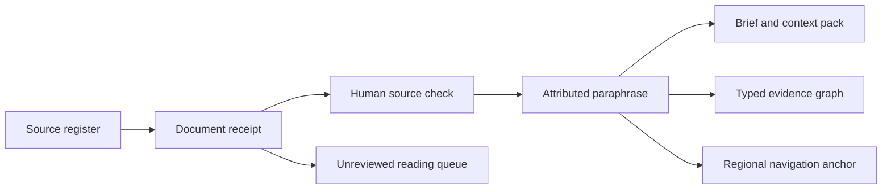

# Syria · Political Analysis

An independent, public-source research toolkit by Giulio Catanzariti. Start with a source, preserve what it actually says, and keep the analyst's judgement visible.

The corpus contains **28 source profiles, 21 document references, nine attributed report paraphrases, nine regional navigation anchors, eight context themes and two social-account links verified through institutional profiles**. Twelve document references were collected from two verified RSS feeds on 2 November 2026. No social posts have been collected. Six selected institutional relationships have separately cited profile evidence.

This is a working foundation, not comprehensive coverage or a live intelligence service. It does not infer current territorial control, assign coordinates to headlines, or score a publisher's credibility.

## Start locally

Python 3.11 or later; no runtime dependencies. Run from this repository:

```sh
python -m venv .venv
. .venv/bin/activate
python -m pip install -e '.[dev]'
syria-analysis validate
python -m unittest discover -s tests -v
```

Without installing the package, prefix commands with `PYTHONPATH=src python -m syria_analysis` in place of `syria-analysis`.

## Workflows

### Interactive source atlas

Open [the built atlas](exports/atlas/index.html) in a browser, or rebuild it from the current validated corpus:

```sh
syria-analysis build-atlas
```

The result is one self-contained HTML file. It works offline without a server, remote scripts, tracking, credentials or runtime dependencies. It is a curated research snapshot, not a live intelligence feed.

The atlas provides:

- A source-to-theme network and a separate documented-relationship graph, with keyboard-selectable records and evidence inspectors.
- Search and combined role, language and theme filters; a complete text directory; visible strengths, limits, access caveats and profile check dates.
- Distinct state-media and monitoring/advocacy categories, alongside local reporting, wires, research institutions, analysts and official primary sources.
- A dated evidence desk and an explicitly unreviewed reading queue.
- Up to three source comparisons and a Markdown worksheet export separating evidence, analyst assessment, alternative explanations and gaps. Drafts are held only in the open page and cleared by reload.
- Light/dark themes and a responsive directory alternative to the horizontally scrollable graph.

Relationship records in [relationships.json](data/sources/relationships.json) contain the exact relation, basis, original profile evidence, review date and caveat. Unknown start/end dates remain null. A first-party disclosure is not an independent audit; no missing edge establishes independence. See [atlas documentation](docs/atlas.md) for graph semantics and checks.

On Windows, use `$env:PYTHONPATH='src'` then `python -m syria_analysis build-atlas` if the package is not installed. The generated file opens directly from Explorer. For browser automation tools that prohibit `file:` URLs, run `python -m http.server 8766 --bind 127.0.0.1` and visit `http://127.0.0.1:8766/exports/atlas/index.html`.

### Command-line research

```sh
# Explicit refresh of the two registered, verified endpoints; titles and links only.
syria-analysis collect-rss --limit 6

# Select a registered feed rather than scraping an arbitrary site.
syria-analysis collect-rss --source syria-direct --limit 6

# Reusable context for an AI agent or a human researcher.
syria-analysis build-context

# Assemble dated source material for one area. The assessment is left for you.
syria-analysis brief --question "What does the Homs project announcement establish?" \
  --place area-homs-urban-recovery --output exports/homs-brief.md

# Inspectable evidence relationships, usable in graph tooling.
syria-analysis export-graph --format graphml
syria-analysis export-graph --format json
syria-analysis export-csv
```

`brief` is deterministic source assembly. The question titles the brief; it does not trigger an AI answer or claim to have answered the question. Add your own assessment with `--analyst-note`, or use the [AI research prompts](prompts/briefing.md) with an explicit model of your choice. No model service or API key is configured here.

To register a public X/Twitter post reference, use `syria-analysis import-post --url PUBLIC_POST_URL --note "Why this needs review"`. Supply a real `/account/status/numeric-id` URL. This records metadata only: no post text is fetched, no publication time is guessed, and no location is inferred. Two account links are documented in [accounts.json](data/social/accounts.json); their institutional-profile provenance does not verify the authorship or content of an individual post.

## From source to brief



The exported evidence graph records provenance, not political affiliations or causal relationships. A line means something specific: a publisher issued a record, a document supports an attributed paraphrase, or a context theme suggests further reading. The atlas's separate documented-relationship view uses explicitly cited institutional profile records; those edges are not added to the evidence graph or treated as corroboration.

| Material | Location | What it contains |
| --- | --- | --- |
| Source directory | [data/sources](data/sources) | Institutional profiles, languages, remit, strengths, limits and verification evidence |
| Receipts | [data/documents](data/documents) | Original URLs, distinct publication/retrieval dates, reporting periods and review state |
| Curated record | [data/claims](data/claims) | Attributed paraphrases, source locators and qualifications |
| Geography | [data/places](data/places) | Approximate navigation points with explicit location basis |
| Context | [data/context](data/context) | Institutional context, dated document summaries and research questions |
| Social sources | [data/social](data/social) | Profile-linked account provenance; initially no posts |
| Contracts | [schemas](schemas) | JSON Schema 2020-12 record contracts |
| Exports | [exports](exports) | JSON, JSONL, GraphML, CSV and an example source briefing |

## Read before using the data

- [Method and review states](docs/methodology.md)
- [Data contract and date precision](docs/data-contract.md)
- [Sources, coverage and refresh](docs/sources.md)
- [Using context with an AI analyst](docs/ai-context.md)
- [Graph semantics](docs/graph.md)
- [Research agenda](docs/research-agenda.md)

The companion [Syria analysis desk](https://giulio-catanzariti-atlas.sargonx6.chatgpt.site/syria) is part of a separate personal website with private access. It provides a map, a source directory and a local briefing workspace. This repository and its public records are available independently.

## Automation and contributions

CI validates the committed corpus and exercises collection parsing, provenance, date handling, geographic boundaries, graph integrity and exports. The manual **Collect public references** workflow produces a downloadable artifact; it does not silently push refreshed data. There is no scheduled collection.

For a correction, identify the record ID, original source, relevant passage or page, date and proposed change. Never submit private messages, personal contact lists, non-public documents or precise locations of vulnerable people. See [CONTRIBUTING.md](CONTRIBUTING.md).

Code: [MIT](LICENSE). Original annotations and compilation: [CC BY 4.0](DATA-LICENSE.md). Linked publishers retain their rights; full articles and UN reports are not bundled. This independent project is not an official UN product and does not represent any former employer.
