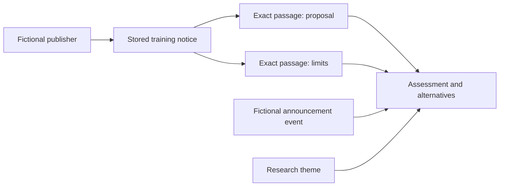

# Practice: an announcement is not an outcome

**All actors, events, notice text and scenario dates in `training-case.json` are fictional.** The reserved `example.org` address is a reference placeholder, not a retrieved news story. No real person or incident is represented. This fixture teaches the workflow; it is not part of the Syria evidence corpus.

The question is realistic: *what does a public announcement actually establish?* An invented council notice proposes a community centre without confirming a budget, work begun or an opening date. Two claims quote different sentences. A note explains why the document supports a proposal being announced but not an implementation finding, and lists other records that could change the assessment.



The diagram is a reading sequence. In the application, edge labels show the actual reference direction (`published_by`, `cites_excerpt_from`, `references`), not causation or organizational control.

## Load it

After installing the desk, run:

```sh
analysis-desk-admin --database var/desk.sqlite3 restore-case --input examples/training-case.json
```

Open the desk following the [beginner quickstart](../docs/quickstart.md). The fixture contains eight records across all seven record kinds. Its current confidence values remain unassessed; the exercise does not assign a publisher reliability score. Every record retains explicit synthetic provenance.

## Try these checks

- Add a note containing a competing explanation and link it to the same document. A backlink means a reference exists; it is not corroboration.
- Attempt to save a claim with an excerpt that is absent from the stored notice. The server rejects it and the draft remains visible.
- Add harmless context to the document. Earlier claims retain their cited revision. An edit that removes a currently cited passage is rejected.
- Revise the assessment after adding evidence, and inspect the earlier revision rather than silently rewriting history.
- Export the case, restore it into a clean database and compare IDs, links and history. Conflicting existing case/record IDs are rejected without overwriting.

## Useful patterns for real cases

The same structure can examine an official promise versus implementation, displaced-population estimates versus their definitions, policy objectives versus legal effect, differing reports that share one origin, or institutional roles that change over time. State the geographic and temporal scope. Keep source claims distinct from your interpretation and look for contrary evidence.

This example is validated in the test suite. Maintainers can regenerate it with `python scripts/build_training_case.py` after installing desk dependencies; the generator uses a fresh temporary database and does not read or edit private research.
